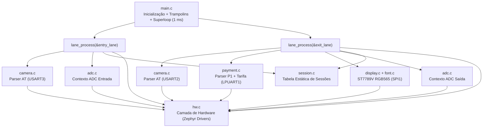
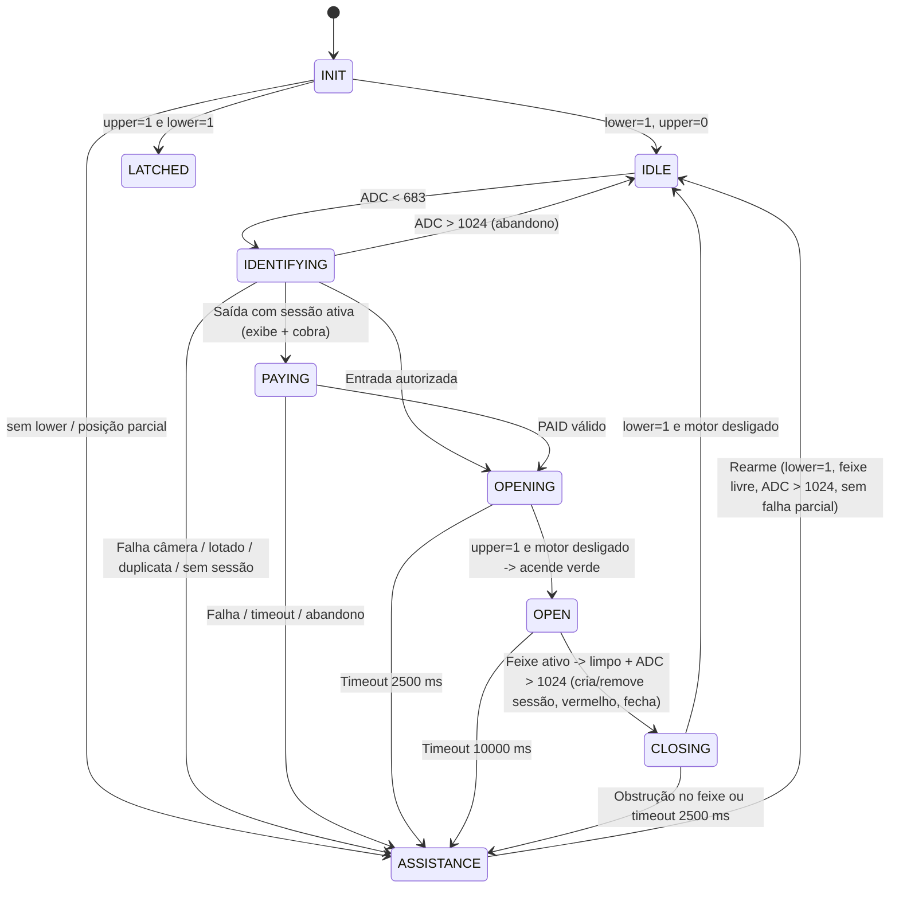

# Guia de Estudo do Projeto — Controlador de Estacionamento em Zephyr RTOS (`v1`)

Este documento é um guia de estudo completo para compreender tanto a **implementação do código presente nesta branch (`v1`)** quanto os **conceitos fundamentais de Sistemas Embarcados e RTOS (Zephyr)** aplicados no controlador de estacionamento de duas faixas para a placa `parking_lot_u5` (baseada no microcontrolador ARM Cortex-M33 **STM32U5A5ZJ**, simulado no **Renode**).

---

## Sumário

1. [Visão Geral do Problema e Hardware Simulado](#1-visão-geral-do-problema-e-hardware-simulado)
2. [Arquitetura de Software da Versão `v1`](#2-arquitetura-de-software-da-versão-v1)
3. [Conceitos Fundamentais de Sistemas Embarcados no Código](#3-conceitos-fundamentais-de-sistemas-embarcados-no-código)
   - [3.1 Devicetree e Abstração de Pinos](#31-devicetree-e-abstração-de-pinos)
   - [3.2 Superloop Cooperativo vs. Interrupções (ISRs)](#32-superloop-cooperativo-vs-interrupções-isrs)
   - [3.3 Interrupções Externas (GPIO / EXTI) e Tempo de Resposta](#33-interrupções-externas-gpio--exti-e-tempo-de-resposta)
   - [3.4 Conversão Analógico-Digital Assíncrona (ADC4 + `k_poll_signal`)](#34-conversão-analógico-digital-assíncrona-adc4--k_poll_signal)
   - [3.5 Histerese Digital contra Ruído de Sensor](#35-histerese-digital-contra-ruído-de-sensor)
   - [3.6 Comunicação Serial UART Orientada a Interrupção e Reconstrução de Quadros](#36-comunicação-serial-uart-orientada-a-interrupção-e-reconstrução-de-quadros)
   - [3.7 Barramento SPI 4-Fios e Controlador Gráfico ST7789V](#37-barramento-spi-4-fios-e-controlador-gráfico-st7789v)
   - [3.8 Temporização Não-Bloqueante com Relógio Monotônico (`k_uptime_get`)](#38-temporização-não-bloqueante-com-relógio-monotônico-k_uptime_get)
   - [3.9 Alocação Estática de Memória (Zero `malloc`)](#39-alocação-estática-de-memória-zero-malloc)
4. [Estudo Detalhado Módulo por Módulo (`student/src/`)](#4-estudo-detalhado-módulo-por-módulo-studentsrc)
   - [4.1 `Kconfig`, `prj.conf` e `CMakeLists.txt`](#41-kconfig-prjconf-e-cmakelistsTxt)
   - [4.2 `hw.h` e `hw.c` — Camada de Abstração de Hardware (HAL)](#42-hwh-e-hwc--camada-de-abstração-de-hardware-hal)
   - [4.3 `adc.h` e `adc.c` — Gerenciador de Distância Assíncrono](#43-adch-e-adcc--gerenciador-de-distância-assíncrono)
   - [4.4 `camera.h` e `camera.c` — Protocolo AT de Reconhecimento de Placas](#44-camerah-e-camerac--protocolo-at-de-reconhecimento-de-placas)
   - [4.5 `payment.h` e `payment.c` — Protocolo P1, Idempotência e Cálculo de Tarifa](#45-paymenth-e-paymentc--protocolo-p1-idempotência-e-cálculo-de-tarifa)
   - [4.6 `session.h` e `session.c` — Tabela de Sessões de Estacionamento](#46-sessionh-e-sessionc--tabela-de-sessões-de-estacionamento)
   - [4.7 `font.h`/`font.c` e `display.h`/`display.c` — Renderização RGB565 via SPI](#47-fonthfontc-e-displayhdisplayc--renderização-rgb565-via-spi)
   - [4.8 `lane.h` e `lane.c` — Máquina de Estados Finitos (FSM) da Faixa](#48-laneh-e-lanec--máquina-de-estados-finitos-fsm-da-faixa)
   - [4.9 `main.c` — Inicialização, Trampolins de Callback e Laço Principal](#49-mainc--inicialização-trampolins-de-callback-e-laço-principal)
5. [Testes de Unidade Embarcados com `ztest` e `FFF`](#5-testes-de-unidade-embarcados-com-ztest-e-fff)
6. [Análise Crítica de Engenharia: Pontos de Atenção na Arquitetura `v1`](#6-análise-crítica-de-engenharia-pontos-de-atenção-na-arquitetura-v1)

---

## 1. Visão Geral do Problema e Hardware Simulado

O sistema controla simultaneamente **duas faixas independentes** de um estacionamento (uma **faixa de entrada** e uma **faixa de saída**) compartilhando um pátio com capacidade configurável (`CONFIG_PARKING_CAPACITY`, padrão 4 vagas) e um único conversor analógico-digital (`ADC4`).

### Periféricos conectados ao STM32U5A5ZJ (`parking_lot_u5`)

| Equipamento | Faixa de Entrada | Faixa de Saída | Periférico / Barramento |
|---|---|---|---|
| Motor da cancela (`enable` / `direction`) | `PB12` / `PB13` | `PB1` / `PB2` | GPIO Output (ativo alto) |
| Fins de curso (`upper` 90° / `lower` 0°) | `PC5` / `PC6` | `PC2` / `PC3` | GPIO Input + EXTI (ativo alto, pull-down) |
| Feixe óptico de passagem / obstrução | `PC8` | `PC4` | GPIO Input + EXTI (ativo alto, pull-down) |
| Semáforo (`red` / `green`) e `buzzer` | `PE2` / `PE3` / `PE4` | `PD1` / `PD2` / `PD3` | GPIO Output (ativo alto) |
| Sensor analógico de distância (`0..6000 mm`) | Canal 17 (`PD13`) | Canal 18 (`PB0`) | `ADC4` (12 bits, `0..4095`) |
| Câmera LPR de leitura de placa | `USART3` (`PD8`/`PD9`) | `USART2` (`PD5`/`PD6`) | UART 115200 bps (protocolo `AT`, `CRLF`) |
| Terminal de pagamento simulado | — | `LPUART1` (`PG7`/`PG8`) | UART 115200 bps (protocolo `P1`, `LF`) |
| Display colorido `240x320` RGB565 | — | `SPI1` (`PA5`/`PA6`/`PA7`) + `CS PD14`, `D/C PD15`, `RST PE0` | SPI 4-fios (`ST7789V`) |

No simulador Renode, **nenhuma mensagem de console (`printk`) aciona atuadores ou conta como resultado**: os modelos físicos e de protocolo inspecionam diretamente os níveis elétricos dos pinos GPIO, as conversões reais nos registradores do `ADC4`, os bytes transmitidos nas `UARTs` e os quadros de pixels enviados via `SPI1`.

---

## 2. Arquitetura de Software da Versão `v1`

A versão `v1` divide o firmware em camadas horizontais e módulos funcionais coesos, reutilizando a mesma máquina de estados (`lane_ctx_t`) para ambas as faixas:



**Por que separar `hw.c` dos demais módulos?**
Em sistemas embarcados profissionais, acoplar chamadas diretas de registradores ou APIs do RTOS (`gpio_pin_set_dt`, `spi_write`, `uart_poll_out`) dentro da lógica de negócio impede testar regras de negócio sem o hardware real. Isolando o hardware em `hw.h`, os módulos `session.c`, `camera.c` e `payment.c` tornam-se testáveis com **dublês de teste (fakes do FFF)** em `student/tests/unit/`.

---

## 3. Conceitos Fundamentais de Sistemas Embarcados no Código

### 3.1 Devicetree e Abstração de Pinos
No Zephyr RTOS, o código C **nunca usa números mágicos de portas ou pinos** (como `GPIOB, 12`). Toda a topologia física da placa é descrita em um arquivo **Devicetree (`.dts`)**, compilado em tempo de build em macros C de custo zero em tempo de execução.

Em `student/src/hw.c`, os periféricos são obtidos por `DT_ALIAS(...)`:
```c
static const struct gpio_dt_spec motor_enable[] = {
    [LANE_ENTRY] = GPIO_DT_SPEC_GET(DT_ALIAS(entry_motor_enable), gpios),
    [LANE_EXIT]  = GPIO_DT_SPEC_GET(DT_ALIAS(exit_motor_enable), gpios),
};
```
- **`struct gpio_dt_spec`** encapsula simultaneamente o ponteiro para o controlador de porta (`&gpiob`), o número do pino (`12`) e as flags elétricas (`GPIO_ACTIVE_HIGH` / `GPIO_ACTIVE_LOW` / `GPIO_PULL_DOWN`).
- Se a placa mudar de revisão e o motor passar do pino `PB12` para `PA4`, **nenhuma linha de código C precisa ser alterada** — basta recompilar com o novo `.dts`.

### 3.2 Superloop Cooperativo vs. Interrupções (ISRs)
Em vez de criar dezenas de threads concorrentes (o que consome pilhas de RAM dedicadas e exige mutexes complexos em cada variável compartilhada), `v1` adota um padrão clássico de firmware de controle determinístico: **Arquitetura Foreground/Background (ISR + Superloop)**:
- **Foreground (ISRs de Hardware):** Reagem instantaneamente a eventos assíncronos urgentes:
  - Interrupções `EXTI` nos fins de curso e no feixe óptico (`limit_upper_isr`, `limit_lower_isr`, `beam_isr`).
  - Interrupções `UART RX` recebendo fragmentos de bytes das câmeras e do terminal (`camera_uart_isr`, `payment_uart_isr`).
- **Background (Superloop em `main.c`):** Um laço infinito com passo de `1 ms` (`k_msleep(1)`) executa de forma sequencial e não-bloqueante `lane_process(&entry_lane, now)` e `lane_process(&exit_lane, now)`, verificando prazos (*timeouts*), transições de estado e aquisições de ADC.

### 3.3 Interrupções Externas (GPIO / EXTI) e Tempo de Resposta
Dois requisitos de segurança física exigem reação imediata:
1. **Parada nos fins de curso (`REQ-06`):** O modelo mecânico não desliga o motor sozinho quando o braço bate em `0°` ou `90°`. Quem desliga o motor é o firmware ao detectar a borda do fim de curso.
2. **Obstrução durante fechamento (`REQ-08`):** Se algo cortar o feixe óptico enquanto a cancela desce, o motor **deve ser desligado em até `10 ms`**, sem reverter automaticamente.

Em `hw.c`, os pinos de entrada são configurados com `GPIO_INT_EDGE_BOTH` (interrupção tanto na subida quanto na descida do sinal). Quando o feixe sobe para nível alto durante `LANE_STATE_CLOSING`, o callback `lane_on_beam()` é chamado diretamente a partir da ISR do controlador `EXTI`, executando `lane_stop_motor(ctx)` em poucos microssegundos — ordens de grandeza abaixo do limite de `10 ms`.

### 3.4 Conversão Analógico-Digital Assíncrona (ADC4 + `k_poll_signal`)
Uma leitura síncrona (`adc_read`) bloquearia a CPU esperando o conversor terminar. Se o conversor travasse ou demorasse, o firmware ficaria cego a prazos de motor ou obstruções.

Por isso (`REQ-10`), `hw.c` utiliza `adc_read_async()` acoplado a um `struct k_poll_signal`:
1. **`k_poll_signal_reset(&adc_signal[lane])`**: limpa o sinalizador antes de iniciar.
2. **`adc_read_async(adc_dev, &adc_seq[lane], &adc_signal[lane])`**: dispara a conversão por hardware e retorna imediatamente à CPU.
3. **`k_poll_signal_check(&adc_signal[lane], &signaled, &result)`**: consulta em `O(1)` (sem bloquear!) se a ISR do `ADC4` já depositou a amostra de 12 bits em `adc_sample_buf[lane]`.
4. **Vida útil de buffers DMA/Assíncronos:** `adc_sample_buf`, `adc_seq` e `adc_signal` são alocados estaticamente em `hw.c` (segmento `.bss`), nunca na pilha (*stack*) de uma função. Se eles estivessem na *stack* e uma função retornasse por *timeout*, uma interrupção atrasada do ADC escreveria em memória já reutilizada por outra função (*stack corruption*).

### 3.5 Histerese Digital contra Ruído de Sensor
O sensor de distância fornece um código proporcional à distância (`codigo = distancia_mm * 4095 / 6000`), mas o ambiente injeta ruído aleatório de até `±64` códigos ADC.

Se o firmware usasse um **único limiar** (ex.: `< 683` presente e `>= 683` ausente), um veículo parado exatamente a `1000 mm` (código base `682`) oscilaria a cada `10 ms` entre `618` e `746`, disparando falsas chegadas e falsos abandonos continuamente!

A solução implementada em `adc.h` é uma **janela de histerese (Schmitt Trigger por software)**:
- **Limiar de chegada (`ADC_THRESHOLD_PRESENT = 683`, ~1000 mm):** Só considera que o carro chegou quando `raw < 683`.
- **Limiar de saída (`ADC_THRESHOLD_DEPARTED = 1024`, ~1500 mm):** Só considera que o carro saiu/abandonou quando `raw > 1024`.
- **Zona morta (`683 .. 1024`):** Largura de `341` códigos — mais de **5 vezes a amplitude máxima do ruído (`64`)**. Uma vez iniciada a identificação em `682`, oscilações até `746` permanecem dentro da zona morta e **não** abortam a captura.

### 3.6 Comunicação Serial UART Orientada a Interrupção e Reconstrução de Quadros
Na comunicação UART real (e no modelo `ParkingProtocols` do Renode), uma mensagem como `+PLATE:17,"ABC1D23",93\r\n` **não chega inteira de uma vez**: ela chega fragmentada em pedaços de 2 a 8 bytes separados por intervalos de `10 ms`.

Isso exige um **analisador de fluxo (*stream parser*) com acumulador limitado**:
- Em `hw.c`, `camera_uart_isr` e `payment_uart_isr` drenam a FIFO de hardware com `uart_fifo_read()` e entregam os fragmentos a `camera_rx_feed()` / `payment_rx_feed()`.
- O módulo vai acumulando os bytes em `rx_buf[128]` até encontrar o delimitador de quadro (`\r\n` na câmera; `\n` no terminal de pagamento).
- Se uma linha corrompida ultrapassar `128` bytes sem terminador, o parser descarta todos os bytes excedentes até encontrar `\n` (*frame resynchronization*), protegendo contra *buffer overflow* e impedindo que um prefixo truncado seja interpretado como comando válido.

### 3.7 Barramento SPI 4-Fios e Controlador Gráfico ST7789V
O display `ST7789V` (`240×320`, `RGB565` = 16 bits por pixel, *big-endian*) usa interface **SPI de 4 fios**:
- `SCK`, `MOSI` (dados seriais síncronos na `SPI1`)
- `CS` (`Chip Select`, `PD14`, ativo baixo): delimita cada transação SPI
- `D/C` (`Data / Command`, `PD15`): nível `0` indica que o byte na SPI é um **registrador/comando** (ex.: `0x2A CASET`, `0x2C RAMWR`); nível `1` indica que os bytes seguintes são **parâmetros ou pixels**.
- `RESET` (`PE0`, ativo baixo): pulso físico de reinicialização do controlador gráfico.

Para desenhar texto sem precisar de um *framebuffer* completo na RAM do microcontrolador (que consumiria `240 × 320 × 2 = 153,6 KB` de SRAM!), `display.c` define janelas retangulares (`CASET` para colunas `x0..x1`, `RASET` para linhas `y0..y1`) e transmite em `RAMWR` apenas os pixels da região sendo desenhada, consultando a tabela de glifos `8×16` em Flash (`const uint8_t font_data[][]` em `font.c`).

### 3.8 Temporização Não-Bloqueante com Relógio Monotônico (`k_uptime_get`)
Todos os prazos operacionais no controle das faixas usam comparações de tempo virtual monotônico em milissegundos (`int64_t now_ms = k_uptime_get()`):
- Captura da câmera: `deadline_ms = k_uptime_get() + 1000`
- Retransmissão de pagamento: `deadline_ms = k_uptime_get() + 1000`
- Abertura/fechamento de motor: `(now_ms - motor_start_ms) >= 2500`
- Passagem pelo feixe: `(now_ms - open_start_ms) >= 10000`
- Pulso de assistência do buzzer: `now_ms >= buzzer_end_ms` (`+100 ms`)

Usar timestamps absolutos em `int64_t` evita bloqueios cruzados entre as duas faixas: enquanto a saída aguarda uma resposta lenta de pagamento de `1500 ms`, a entrada continua monitorando seu motor e seu feixe óptico a cada milissegundo.

### 3.9 Alocação Estática de Memória (Zero `malloc`)
Em conformidade com boas práticas de sistemas embarcados críticos (MISRA-C / IEC 61508), **nenhum módulo utiliza alocação dinâmica (`malloc`/`free`)**. Toda a memória (`entry_lane`, `exit_lane`, `sessions[CONFIG_PARKING_CAPACITY]`, buffers UART e ADC) é alocada estaticamente em tempo de compilação, eliminando fragmentação de *heap* e falhas de falta de memória em tempo de execução.

---

## 4. Estudo Detalhado Módulo por Módulo (`student/src/`)

### 4.1 `Kconfig`, `prj.conf` e `CMakeLists.txt`
- **`Kconfig`:** Define os símbolos customizados `CONFIG_PARKING_CAPACITY` (1..8, padrão 4) e `CONFIG_PARKING_TARIFF_UNIT_MS` (1000..60000 ms, padrão 60000 ms), expostos automaticamente como macros C pelo sistema de build do Zephyr.
- **`prj.conf`:** Habilita os subsistemas do kernel: `CONFIG_GPIO=y`, `CONFIG_ADC=y`, `CONFIG_ADC_ASYNC=y`, `CONFIG_SERIAL=y`, `CONFIG_UART_INTERRUPT_DRIVEN=y`, `CONFIG_SPI=y` e `CONFIG_NEWLIB_LIBC=y`.
- **`CMakeLists.txt`:** Declara o executável da aplicação e compila os 9 arquivos `.c` de `src/`.

### 4.2 `hw.h` e `hw.c` — Camada de Abstração de Hardware (HAL)
Concentra todas as estruturas específicas de driver do Zephyr:
- **Saídas GPIO:** `hw_motor_enable`, `hw_motor_direction`, `hw_light_red`, `hw_light_green`, `hw_buzzer` mapeiam `lane_id_t` (`LANE_ENTRY = 0`, `LANE_EXIT = 1`) para `gpio_pin_set_dt()`.
- **Entradas e EXTI:** `hw_register_limit_upper_cb`, `hw_register_limit_lower_cb` e `hw_register_beam_cb` configuram os pinos como `GPIO_INPUT`, ativam `GPIO_INT_EDGE_BOTH` e associam `struct gpio_callback` às ISRs que repassam eventos para a máquina de estados.
- **UARTs:** `hw_uart_camera_init` e `hw_uart_payment_init` registram callbacks de interrupção RX (`uart_irq_callback_user_data_set` + `uart_irq_rx_enable`), enquanto `hw_uart_*_send` transmite byte a byte de forma determinística via `uart_poll_out()`.
- **ADC4:** `hw_adc_init` configura os canais 17 e 18 (`adc_channel_setup`), inicializa os sinais `k_poll_signal` e prepara `struct adc_sequence` com resolução de 12 bits; `hw_adc_read_async` inicia a leitura e `hw_adc_check_completion` verifica o término sem bloquear.
- **SPI Display:** `hw_display_write_cmd` coloca `D/C = 0` e envia 1 byte de comando via `spi_write`; `hw_display_write_data` coloca `D/C = 1` e envia o buffer de parâmetros ou pixels.

### 4.3 `adc.h` e `adc.c` — Gerenciador de Distância Assíncrono
Mantém a estrutura `adc_ctx_t` de cada faixa (`pending`, `valid`, `fault`, `last_raw`, `submit_ms`):
- `adc_submit()` solicita uma nova conversão se nenhuma estiver pendente e registra `submit_ms`.
- `adc_poll()` verifica se `(now_ms >= submit_ms + 100)` — caso positivo, trava `fault = true` (`-ETIMEDOUT`). Caso contrário, consulta `hw_adc_check_completion()` e atualiza `last_raw` e `valid = true`.
- `adc_is_car_present()` e `adc_is_car_departed()` aplicam os limiares com histerese (`< 683` e `> 1024`) exigindo `ctx->valid == true`.

### 4.4 `camera.h` e `camera.c` — Protocolo AT de Reconhecimento de Placas
Implementa o cliente do protocolo `AT+CAPTURE=<id>\r\n`:
- **Validação sintática (`camera_validate_plate`):** Verifica exatamente 7 caracteres no padrão brasileiro antigo (`ABC1234`) ou Mercosul (`ABC1D23`): `[A-Z]{3}[0-9][A-Z0-9][0-9]{2}`.
- **Máquina de captura:**
  1. `camera_start_capture()` incrementa `global_capture_id`, envia `AT+CAPTURE=<id>\r\n`, entra em `CAMERA_STATE_WAIT_OK` e agenda `deadline_ms = now + 1000`.
  2. Ao receber `OK\r\n`, avança para `CAMERA_STATE_WAIT_PLATE` (sem reiniciar o prazo de `1000 ms`!).
  3. Ao receber `+PLATE:<id>,"<placa>",<conf>\r\n`, confere ausência de zeros à esquerda, igualdade de `<id>` com `ctx->capture_id`, validade da placa e faixa `0..100` da confiança.
  4. Se `confidence >= 85`, conclui em `CAMERA_STATE_DONE`. Se `< 85` (ou se estourar `1000 ms` em `camera_process()`), chama `camera_start_next_attempt()` com um **novo ID** até o limite de 3 tentativas (`CAMERA_STATE_FAILED`).

### 4.5 `payment.h` e `payment.c` — Protocolo P1, Idempotência e Cálculo de Tarifa
Gerencia a cobrança na saída (`LPUART1`, terminador `\n`):
- **Fórmula inteira da tarifa (`payment_calc_tariff`):**
  $$\text{unidades} = \max\left(1, \left\lceil \frac{\text{elapsed\_ms}}{\text{unit\_ms}} \right\rceil\right), \quad \text{centavos} = 200 + (\text{unidades} - 1) \times 100$$
  Em C, a divisão inteira arredondada para cima (*ceiling*) é calculada **sem ponto flutuante** (`double`/`float` evitados em embarcados para prevenir imprecisão de centavos!) usando `(elapsed_ms + unit_ms - 1) / unit_ms`. Acima de `9999` unidades, retorna `-1` para acionar assistência sem estourar o limite de `1000000` centavos do protocolo.
- **Idempotência com UUID (`payment_start_charge` e `payment_process`):**
  Gera um UUID único de 36 caracteres (`8-4-4-4-12`) por tentativa de saída e congela `amount_centavos`. Se não houver resposta em `1000 ms`, reenvia **exatamente o mesmo UUID e valor** (até 3 envios totais), garantindo que o terminal reconheça a retransmissão sem cobrar duas vezes.
- **Cancelamento seguro (`payment_cancel`):**
  Salva uma cópia local do UUID, **zera `ctx->uuid` primeiro** (invalidando qualquer resposta tardia em trânsito) e em seguida transmite `P1 CANCEL <uuid>\n`.

### 4.6 `session.h` e `session.c` — Tabela de Sessões de Estacionamento
Gerencia o vetor estático `sessions[CONFIG_PARKING_CAPACITY]`:
- `session_create(plate, entry_time_ms)` rejeita placas duplicadas ou pátio cheio e grava o instante virtual exato em que o veículo concluiu a passagem de entrada.
- `session_find(plate)` localiza a sessão ativa na saída para cálculo do tempo estacionado.
- `session_remove(plate)` libera a vaga somente após a passagem física completa na saída.

### 4.7 `font.h`/`font.c` e `display.h`/`display.c` — Renderização RGB565 via SPI
- **`font.c`:** Tabela de bitmaps `8×16` cobrindo ASCII `0x20` (`' '`) a `0x5A` (`'Z'`), onde cada byte representa uma linha de 8 pixels (`0x80 >> col` testa cada pixel da esquerda para a direita).
- **`display_init()`:** Executa reset físico, `SWRESET (0x01)`, `SLPOUT (0x11)`, `COLMOD (0x3A -> 0x55)` para RGB565, `MADCTL (0x36 -> 0x00)` e `DISPON (0x29)`.
- **`display_payment_screen()`:** Limpa o fundo em preto e centraliza quatro linhas obrigatórias via SPI real: a **placa**, o valor **`BRL r.cc`**, **`SIMULATED PAYMENT`** e **`NOT PIX`**.

### 4.8 `lane.h` e `lane.c` — Máquina de Estados Finitos (FSM) da Faixa
Cada faixa evolui por 9 estados bem definidos:



Destaques de segurança na FSM:
- **Regra da Luz Verde (`REQ-06`):** Em `lane_state_opening()`, o sinal verde **jamais** acende antes de confirmar simultaneamente `ctx->limit_upper_active && !ctx->motor_running`.
- **Ciclo Completo de Passagem (`REQ-07`):** A vaga só é ocupada/liberada em `lane_state_open()` quando `beam_was_active && beam_cleared && !beam_active && adc > 1024`. Abrir a cancela ou pagar sem atravessar o feixe não altera sessões.
- **Distinção de Falhas em Assistência (`REQ-09`):**
  - *Falhas com cancela fechada* (3 erros de câmera, lotado, pagamento recusado) permitem **rearme automático** assim que o carro recua além de `1500 mm` (`ADC > 1024`) com feixe livre.
  - *Falhas de posição parcial* (`partial_position` ou `obstruction_fault`) bloqueiam o rearme automático para nunca mover um braço em posição incerta.
  - *Falhas críticas* (`LANE_STATE_LATCHED`: fins de curso contraditórios ou falha de ADC) permanecem travadas até o *reset* da máquina.

### 4.9 `main.c` — Inicialização, Trampolins de Callback e Laço Principal
Orquestra a subida segura do sistema: configura saídas em estado seguro (motor desligado, verde apagado, vermelho aceso), inicializa sessões e display, registra os 6 callbacks EXTI passando o ponteiro `&entry_lane` ou `&exit_lane` como `user_data` (padrão *context pointer* em C para evitar código duplicado), ativa as 3 UARTs e entra no superloop de `1 ms`.

---

## 5. Testes de Unidade Embarcados com `ztest` e `FFF`

Em `student/tests/unit/src/main.c`, utiliza-se o framework oficial do Zephyr (`ztest`) combinado ao **FFF (*Fake Function Framework*, `<zephyr/fff.h>`)**:
```c
FAKE_VALUE_FUNC(int, hw_uart_camera_send, lane_id_t, const uint8_t *, size_t);
FAKE_VALUE_FUNC(int, hw_uart_payment_send, const uint8_t *, size_t);
```
Essa macro gera automaticamente uma implementação substituta (*mock/fake*) que grava quantas vezes a função foi chamada (`call_count`), quais argumentos recebeu e devolve `return_val` configurado pelo teste. Isso permite validar em milissegundos:
- Criação, busca, remoção, rejeição de duplicata e lotação máxima em `session_suite`;
- Expressões válidas/inválidas de placas, montagem de quadros `OK` + `+PLATE`, retentativa por confiança baixa (`60 < 85`) e descarte de ID incorreto em `camera_suite`;
- Arredondamento inteiro da tarifa, *overflow* acima de `9999` unidades, geração de UUID `8-4-4-4-12` e rejeição de UUID/valor divergentes em `payment_suite`.

---

## 6. Análise Crítica de Engenharia: Pontos de Atenção na Arquitetura `v1`

Estudar esta versão `v1` (pré-revisão) é especialmente valioso porque ela ilustra **armadilhas clássicas do desenvolvimento de sistemas embarcados reais** — sutilezas que parecem corretas numa leitura superficial, mas causam falhas em hardware/simulação rigorosa (e que motivaram a refatoração na branch `v2`):

1. **Contenção de Periférico Compartilhado (`ADC4`):**
   Embora existam dois contextos `adc_ctx_t` (um por faixa), ambos conversam com **um único conversor físico `ADC4`**. Chamar `adc_read_async()` na faixa de saída no mesmo passo do loop em que a conversão da faixa de entrada ainda está em andamento disputa o lock interno do driver ADC do Zephyr (`-EBUSY`), exigindo um escalonador único que alterne um canal por vez.
2. **Condição de Corrida (*Data Race*) entre ISR de UART e Loop Principal:**
   Em `v1`, `camera_rx_feed()` e `payment_rx_feed()` rodam **dentro da ISR de UART**, modificando `ctx->state`, `ctx->attempt` e `ctx->deadline_ms` sem seção crítica enquanto `lane_process()` lê/escreve os mesmos campos na thread `main`.
3. **Nível Lógico vs. Nível Elétrico Físico (`GPIO_ACTIVE_LOW` no Reset do Display):**
   No Devicetree, `reset-gpios` do `ST7789V` possui a flag `GPIO_ACTIVE_LOW`. No Zephyr, `GPIO_OUTPUT_ACTIVE` e `gpio_pin_set_dt(..., 1)` colocam o pino em **nível lógico ativo = nível físico BAIXO (`0 V`)**. Como o pino já nasce em `0 V` no reset do MCU, configurá-lo como `ACTIVE` e chamar `set(1) -> set(0)` nunca produz a borda de descida física (`HIGH -> LOW`) exigida pelo modelo `CourseST7789V` para reconhecer o pulso de hardware reset.
4. **Atrasos Bloqueantes (`k_msleep`) na Inicialização do Display:**
   Os `k_msleep(10/120/150/120)` em `display_init()` somam `~400 ms` bloqueando `main()` antes do registro das interrupções EXTI e do início do monitoramento de segurança. Converter a inicialização do display em máquina de estados não-bloqueante elimina toda latência de partida.
5. **Semântica Estrita de Framing e Cancelamento:**
   - No protocolo `P1`, `CR` (`\r`) deve invalidar e descartar a linha inteira até `\n` (em vez de apenas ignorar o caractere `\r` com `continue`).
   - Quadros parciais nas UARTs exigem timeout de montagem de `1000 ms` desde o primeiro byte.
   - Ao esgotar as 3 retransmissões de cobrança por timeout, deve-se enviar `P1 CANCEL <uuid>\n` após invalidar o UUID, antes de entrar em assistência.
   - Na configuração do build do laboratório, `CMakeLists.txt` precisa apontar `BOARD_ROOT` e `DTS_ROOT` para `../hardware` e incluir `boards/zvb/parking_lot_u5/zvb.yml`.
