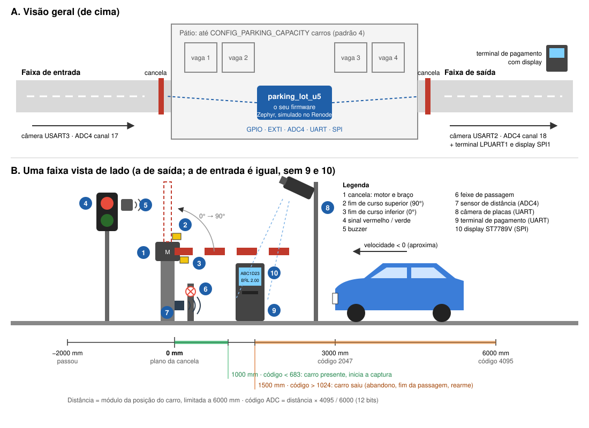

# Desafio: controlador de estacionamento com duas faixas

Este é o enunciado do desafio e a regra de avaliação. O contrato técnico
completo (pinos, protocolos, tempos, modelos) está nos documentos em inglês
ligados abaixo. Quando este texto e um contrato técnico parecerem divergir, o
contrato técnico vale para o comportamento e este texto vale para a nota.

> **Comece aqui.** O repositório da disciplina é
> [github.com/ecom042/emul-parking-lot](https://github.com/ecom042/emul-parking-lot). Tudo o que este enunciado cita
> (documentos técnicos em inglês, código, cenários) está lá. Os passos:
>
> 1. Instale o ambiente com o [guia de instalação](instalacao.md), que clona o
>    repositório.
> 2. Crie o repositório privado da dupla
>    ([como entregar](#como-entregar-repositório-privado-e-pull-request)).
> 3. Rode o primeiro teste e leia os [requisitos](#requisitos).
>
> O enunciado e o guia de instalação também estão num único PDF,
> [`docs/pdf/desafio.pdf`](pdf/desafio.pdf), com o guia no fim.

## O desafio

Em **dupla** e em **uma semana**, vocês vão escrever, em Zephyr RTOS, o
firmware de um estacionamento para a placa `parking_lot_u5`
([trabalho em dupla](#trabalho-em-dupla)). Há uma faixa de entrada e uma de saída funcionando ao mesmo
tempo e até `CONFIG_PARKING_CAPACITY` carros estacionados (padrão 4).

O firmware comanda cancelas, sinais e buzzer por GPIO, mede a distância do
carro pelo ADC4, conversa com duas câmeras e um terminal de pagamento por UART
e desenha o display do terminal por SPI. Nada disso existe fisicamente: o
Renode simula a placa e os equipamentos, e os cenários verificam o que os
periféricos fizeram de fato. **Mensagens no console não contam.** Uma cancela
só "abriu" se o modelo viu o motor ligado na direção certa e o fim de curso
superior acionado.

O ponto de partida em `student/` é inerte de propósito: motor, verde e buzzer
desligados, vermelho aceso. Ele reprova nos cenários até você implementar o
controlador.

Instale o ambiente com o [guia de instalação](instalacao.md) (Linux) e
leia a [especificação do aluno](student-specification.md). Depois
consulte os contratos conforme precisar: [protocolos](device-protocols.md),
[modelos de hardware](hardware-models.md), [modelo físico](physical-model.md)
e [cenários](scenarios.md).

## O cenário



O estacionamento tem uma **faixa de entrada** e uma **faixa de saída**, cada
uma com o mesmo conjunto de equipamentos (① a ⑧ na figura). Só a saída tem o
**terminal de pagamento** ⑨ com o seu **display** ⑩. As duas faixas funcionam
ao mesmo tempo e dividem o mesmo ADC4 e a mesma tabela de sessões. O carro é
um ponto que anda numa reta: começa a 6000 mm da cancela, aproxima-se, cruza o
plano da cancela (0 mm) e termina a −2000 mm, do outro lado.

Um ciclo completo na **entrada**:

1. O carro se aproxima. Com a cancela fechada, a distância fica abaixo de
   1000 mm (código ADC < 683): o firmware pede uma captura à câmera.
2. A câmera responde com a placa e a confiança. Placa válida, confiança
   ≥ 85, sem sessão e com vaga livre: a entrada é autorizada.
3. O firmware liga o motor no sentido de abrir até o fim de curso superior,
   desliga o motor e só então acende o verde.
4. O carro passa: o feixe fica ativo e depois inativo, e a distância passa de
   1500 mm (código > 1024). Só agora a sessão é criada.
5. O firmware apaga o verde, acende o vermelho e fecha a cancela até o fim de
   curso inferior.

Na **saída** é igual, mas entre os passos 2 e 3 a placa precisa ter uma
sessão ativa, o firmware calcula a tarifa, desenha a cobrança no display e
manda a cobrança ao terminal. A cancela só abre com a confirmação `PAID`
correta, e a passagem encerra a sessão e libera a vaga. Qualquer situação
fora do normal leva à **assistência**: motor parado, verde apagado, vermelho
aceso e um pulso no buzzer.

Os pinos de cada faixa estão no [mapa de pinos](hardware-models.md#pin-map).
A placa `parking_lot_u5` (`hardware/boards/ufal/parking_lot_u5/`) é uma cópia
enxuta da Nucleo U5A5ZJ com os equipamentos do estacionamento no devicetree.
Cada equipamento tem um **alias**, então o código nunca usa número de pino:

| Alias (`entry-` ou `exit-`) | Equipamento |
|---|---|
| `<faixa>-motor-enable`, `<faixa>-motor-direction` | ① motor da cancela |
| `<faixa>-limit-upper`, `<faixa>-limit-lower` | ②③ fins de curso |
| `<faixa>-light-red`, `<faixa>-light-green`, `<faixa>-buzzer` | ④⑤ sinais e buzzer |
| `<faixa>-beam` | ⑥ feixe |
| `<faixa>-distance` | ⑦ canal do ADC4 (17 na entrada, 18 na saída) |
| `<faixa>-camera` | ⑧ UART da câmera |
| `payment-terminal`, `payment-display` | ⑨⑩ UART do terminal e display (só na saída) |

```c
static const struct gpio_dt_spec motor =
        GPIO_DT_SPEC_GET(DT_ALIAS(entry_motor_enable), gpios);
static const struct device *const camera = DEVICE_DT_GET(DT_ALIAS(entry_camera));
static const struct adc_channel_cfg distancia =
        ADC_CHANNEL_CFG_DT(DT_ALIAS(entry_distance));
```

Todas as entradas são ativas em nível alto, com
pull-down, e todas as saídas são ativas em nível alto.

### ①②③ Cancela: motor, braço e fins de curso

A "cancela" não é uma saída única: são **duas saídas** que comandam o motor e
**duas entradas** que dizem onde o braço está.

| Sinal | Entrada | Saída | Função |
|---|---|---|---|
| Motor liga (*enable*) | PB12 | PB1 | Alto: o motor gira. Baixo: para no próximo passo de 10 ms. |
| Motor direção | PB13 | PB2 | Alto abre (sobe), baixo fecha (desce). Sozinha não move nada. |
| Fim de curso superior | PC5 (EXTI 16) | PC2 (EXTI 13) | Alto exatamente quando o braço está em 90° (aberta). |
| Fim de curso inferior | PC6 (EXTI 17) | PC3 (EXTI 14) | Alto exatamente quando o braço está em 0° (fechada). |

- O braço gira a 45°/s: de fechado a aberto leva 2 s. O firmware tem
  **2500 ms** para abrir ou fechar; passou disso, é falha (assistência).
- Trocar a direção depois de um movimento custa 100 ms parado.
- **O modelo nunca desliga o motor.** No fim do curso o braço para no batente,
  mas o motor continua ligado até o firmware desligá-lo. Quem para o motor é o
  firmware, ao ver o fim de curso (pela interrupção EXTI).
- Na partida o braço está fechado: inferior aceso, superior apagado.
- Falhas que os cenários podem provocar: **travamento** (o braço não se move e
  o fim de curso esperado nunca chega), **fim de curso ausente** (superior ou
  inferior nunca acende) e **fins de curso contraditórios** (os dois acesos ao
  mesmo tempo, o que trava em assistência até o reset).

### ④⑤ Sinal vermelho/verde e buzzer

| Sinal | Entrada | Saída |
|---|---|---|
| Vermelho / verde / buzzer | PE2 / PE3 / PE4 | PD1 / PD2 / PD3 |

O vermelho fica aceso enquanto o carro espera, é identificado, paga ou a
cancela fecha. O verde só acende com a cancela no fim de curso superior **e o
motor desligado**. Na assistência, o buzzer dá um pulso de 100 ms (o cenário
vê a transição do pino; não há som).

### ⑥ Feixe de passagem e obstrução

Um sensor óptico atravessa a faixa no plano da cancela: PC8 (entrada), PC4
(saída), com EXTI. Alto quer dizer "tem algo no feixe". Ele é **independente**
da distância e do braço: o cenário o aciona quando quer. Serve para duas
coisas:

- **Passagem:** depois de abrir, o feixe precisa ficar ativo e depois inativo,
  com o carro já a mais de 1500 mm, em até 10000 ms.
- **Obstrução:** feixe ativo durante o fechamento obriga a desligar o motor em
  até 10 ms, sem reverter nem religar sozinho.

### ⑦ Sensor de distância (ADC4)

Cada faixa tem um sensor ligado a um canal do **mesmo** conversor ADC4:
canal 17 (PD13) na entrada e canal 18 (PB0) na saída. O código de 12 bits é
proporcional à distância do carro até o plano da cancela:

| Distância | 0 mm | 1000 mm | 1500 mm | 3000 mm | 6000 mm ou mais |
|---|---:|---:|---:|---:|---:|
| Código | 0 | 682 | 1023 | 2047 | 4095 |

- Código **< 683**: o carro chegou (inicia a captura). Código **> 1024**: o
  carro saiu (abandona a identificação ou o pagamento, conclui a passagem,
  rearma depois de uma assistência). Entre os dois, nada muda: é essa folga
  que absorve o ruído.
- O sensor é atualizado a cada 10 ms. O cenário pode somar ruído de até ±64
  códigos.
- Use o driver **assíncrono** (`adc_read_async`): uma conversão por vez,
  alternando os dois canais, com o resultado observado em até 100 ms e sem
  bloquear o resto do firmware enquanto ela não termina.

### ⑧ Câmera de placas (UART)

Cada faixa tem uma câmera numa UART própria: USART3 (PD8 TX / PD9 RX) na
entrada e USART2 (PD5 TX / PD6 RX) na saída. A câmera **não vê o carro**: a
placa e a confiança são configuradas pelo cenário, e o firmware só as conhece
pela UART. O protocolo é de comandos AT, com linhas terminadas em CR LF:

```text
firmware → câmera   AT+CAPTURE=17\r\n
câmera → firmware   OK\r\n                        (aceitou o pedido; ainda não é a placa)
câmera → firmware   +PLATE:17,"ABC1D23",93\r\n     (ID da captura, placa, confiança 0..100)
```

- Cada tentativa usa um **ID novo** e tem 1000 ms para a resposta completa.
  São no máximo três tentativas; confiança < 85 ou prazo esgotado passam à
  próxima. Esgotadas, assistência.
- A resposta chega em pedaços de até 8 bytes, 10 ms entre eles, cerca de
  100 ms depois do pedido. O firmware precisa montar a linha.
- Placa válida: três letras, um algarismo, uma letra ou algarismo, dois
  algarismos (`ABC1D23`, `ABC1234`). Resposta com outro ID, malformada ou com
  mais de 128 bytes é descartada.
- O cenário pode mandar confiança baixa, atrasar a resposta ou só responder
  `OK` e nunca mandar a placa.

### ⑨ Terminal de pagamento (UART)

Só na saída, na LPUART1 (PG7 TX / PG8 RX). Protocolo `P1`, linhas terminadas
só em LF, campos separados por um espaço:

```text
firmware → terminal   P1 CHARGE 3f2a9c10-7b4e-4d21-9a6f-0c5e8b7d12c1 ABC1D23 400 BRL\n
terminal → firmware   P1 RESULT 3f2a9c10-7b4e-4d21-9a6f-0c5e8b7d12c1 PAID 400 BRL\n
```

- Cada tentativa de saída tem um **UUID** novo (36 caracteres hexadecimais
  minúsculos no formato `8-4-4-4-12`). O valor é em **centavos inteiros** e não
  muda depois da primeira cobrança.
- Sem resposta em 1000 ms, reenvie **a mesma** cobrança (mesmo UUID e valor),
  no máximo três envios no total. O terminal reconhece o reenvio e não cobra
  duas vezes.
- Só `PAID` com o UUID atual e o mesmo valor abre a cancela. `CANCELLED`,
  respostas malformadas, de um UUID antigo ou com outro valor nunca abrem.
  Para desistir, invalide o UUID e mande `P1 CANCEL <uuid>\n`.
- O cenário pode atrasar, omitir, cancelar ou corromper a resposta.

A tarifa é `200 + (unidades − 1) × 100` centavos, em que as unidades são o
tempo virtual estacionado, contado desde a passagem na entrada, dividido por
`CONFIG_PARKING_TARIFF_UNIT_MS`, arredondado para cima e no mínimo 1 (60000 ms
por padrão; 1000 ms nos cenários e 5000 ms no laboratório interativo). Exemplo com unidade de 1000 ms: 2,5 s estacionado são 3 unidades,
400 centavos, `BRL 4.00`.

### ⑩ Display do terminal (SPI)

Um controlador ST7789V de 240×320 pixels, em RGB565, na SPI1 (PA5 SCK / PA6
MISO / PA7 MOSI), com chip select PD14 (ativo baixo), D/C PD15 e reset PE0
(ativo baixo). O firmware faz o reset por hardware, a sequência de
inicialização (`SWRESET`, `SLPOUT`, `COLMOD 55`, `MADCTL 00`, `DISPON`) e
desenha com `CASET`/`RASET`/`RAMWR`, com a fonte que quiser. A tela da
cobrança mostra a placa, o valor (`BRL 4.00`), `SIMULATED PAYMENT` e
`NOT PIX`. O cenário lê o que o modelo recebeu pela SPI; texto no console não
conta.

### O que o cenário controla

Os cenários e o navegador só mexem no **ambiente**: velocidade do carro e
próximo carro, feixe, travamento, falhas de fim de curso, ruído do ADC,
configuração da câmera e do terminal, pausa e reset. Eles nunca escrevem nos
pinos de saída nem no código do ADC; o firmware nunca escreve no estado dos
modelos. Os detalhes estão em [modelo físico](physical-model.md),
[protocolos](device-protocols.md) e [cenários](scenarios.md).

## Regras do jogo

1. **Você só entrega `student/`.** A entrega é um pull request
   ([como entregar](#como-entregar-repositório-privado-e-pull-request)); na avaliação, a pasta
   `student/` do PR é copiada para uma árvore limpa do curso. Mudanças em `hardware/`, `models/`,
   `scripts/`, `tests/`, `web/` ou nos documentos são ignoradas. Não adianta
   "consertar" um cenário ou um modelo.
2. **Use os drivers reais do Zephyr**: GPIO/EXTI, ADC4 assíncrono, UARTs e
   SPI. É proibido fabricar leituras, escrever no estado dos modelos pelo host
   ou imprimir o que deveria ser desenhado.
3. **O firmware decide.** Autorização, saídas, novas tentativas, preço e
   sessões são do firmware. Os modelos cuidam de movimento, sensores e
   respostas; os cenários, de estímulos e expectativas.
4. **O tempo é virtual.** Todos os prazos usam o tempo virtual do Renode,
   nunca o relógio do computador.

## Trabalho em dupla

A dupla entrega **um** `student/`, e os 70 pontos medidos sobre ele são os
mesmos para os dois. A **sabatina** (defesa oral, 30 pontos) é **individual**:
cada um responde por todo o código, inclusive pela parte que o colega
escreveu.

- **Um repositório privado para os dois.** Um da dupla cria o repositório e
  adiciona o colega como colaborador. Cada um faz commits com a própria
  identidade do git; o histórico do PR mostra quem fez o quê.
- **A divisão do trabalho é de vocês.** Lembrem que as duas faixas usam o
  mesmo código: dividir "entrada" e "saída" duplica trabalho.
- **Combinem as interfaces no primeiro dia**, antes de codificar: o que a
  máquina de estados de cada faixa chama (por exemplo, pedir uma captura,
  cobrar um valor, desenhar a tela) e quais eventos recebe de volta (placa
  aceita, pagamento confirmado, prazo esgotado). Com isso cada um testa a sua
  parte com falsos do FFF sem esperar o outro.
- **Revisem o código um do outro.** Quem não escreveu um módulo precisa
  conseguir explicá-lo e mudá-lo na sabatina. Reservem o último dia para isso.

Um plano possível para a semana:

| Dia | Trabalho |
|---|---|
| 1 | Os dois instalam o ambiente e rodam o primeiro cenário; leem o desafio; combinam as interfaces e a divisão |
| 2–3 | Implementação, com testes de unidade e cenários |
| 4 | Integração: as duas faixas juntas, a saída com pagamento e display, todos os cenários públicos |
| 5 | Cobertura, análise estática e preparo da sabatina: cada um explica ao outro o que escreveu |

## Requisitos

Cada requisito resume uma parte da
[especificação](student-specification.md#controller-and-safety-requirements).
Os cenários públicos listados exercitam o requisito. Os cenários ocultos usados
na avaliação exercitam os mesmos requisitos com outras combinações (por
exemplo, as duas faixas ao mesmo tempo).

| ID | Requisito | Cenários públicos |
|---|---|---|
| REQ-01 | **Partida segura.** Começa com motor desligado, vermelho aceso e verde apagado. Sem fim de curso inferior em repouso, pede assistência em vez de fechar sozinho. Fins de curso superior e inferior ao mesmo tempo travam em assistência até o reset. | `partial-startup`, `missing-lower`, `contradictory-limits` |
| REQ-02 | **Reconhecimento da placa.** Com a cancela fechada e código ADC recente < 683 (cerca de 1000 mm), inicia a captura. Aceita placa válida com confiança ≥ 85 para o ID de captura atual. São até três tentativas, cada uma com ID novo e prazo de 1000 ms; esgotadas, pede assistência. | `normal`, `confidence-retry`, `low-confidence`, `camera-timeout` |
| REQ-03 | **Presença, não passagem.** Um carro parado continua presente: nada de capturas repetidas. Ruído do ADC perto do limiar não gera chegadas falsas. Durante identificação ou pagamento, código > 1024 (cerca de 1500 mm) abandona a tentativa. | `stationary`, `noisy-threshold` |
| REQ-04 | **Sessões e faixas simultâneas.** Entra uma placa aceita sem sessão quando há vaga; lotado ou placa já estacionada pede assistência. Na saída, só uma placa com sessão ativa paga e sai. As duas faixas funcionam ao mesmo tempo, e a falha ou espera de uma não atrasa a segurança da outra. | `normal` |
| REQ-05 | **Pagamento.** A cobrança é um valor inteiro imutável, e a cancela só abre com `PAID` exato e atual. Retransmite no máximo três vezes, com o mesmo UUID e o mesmo valor. Respostas ausentes, antigas, malformadas, canceladas ou divergentes nunca abrem a cancela. | `payment-delayed`, `payment-missing`, `payment-duplicate`, `payment-stale` |
| REQ-06 | **Movimento da cancela.** Para pelo fim de curso real, nunca por batente. Abrir e fechar têm 2500 ms cada. O verde só acende depois de chegar ao fim de curso superior **com o motor desligado**. | `normal`, `jam`, `missing-upper`, `missing-lower` |
| REQ-07 | **Passagem.** Depois de abrir, exige feixe ativo, depois inativo, com distância > 1024. Só uma passagem completa cria a sessão na entrada ou a encerra na saída. O prazo de passagem é 10000 ms. | `normal`, `obstruction-before-close` |
| REQ-08 | **Fechamento e obstrução.** Apaga o verde e acende o vermelho antes de fechar, com o feixe livre. Obstrução durante o fechamento desliga o motor em até 10 ms, sem reverter nem religar sozinho. | `obstruction-before-close`, `obstruction-during-close` |
| REQ-09 | **Assistência.** Para o motor, apaga o verde, acende o vermelho e dá um pulso de 100 ms no buzzer. Rearma conforme a [especificação](student-specification.md#controller-and-safety-requirements); falhas de posição, fins de curso contraditórios e falhas do ADC ficam travadas até o reset. | `jam`, `low-confidence`, `payment-missing` |
| REQ-10 | **ADC4 assíncrono.** Uma conversão por vez, com buffers que sobrevivem a uma conclusão atrasada, verificada sem bloquear e concluída antes de 100 ms. O trabalho de segurança continua enquanto a conversão está pendente. | `noisy-threshold`, `stationary` |
| REQ-11 | **UARTs robustas.** Dois analisadores independentes e limitados: quadro máximo de 128 bytes, montagem parcial com prazo de 1000 ms, descarte do que estiver malformado até o LF, sem executar prefixos. | `confidence-retry`, `payment-stale` |
| REQ-12 | **Display e tarifa.** O display ST7789V é desenhado via SPI real, com a placa, `BRL r.cc`, `SIMULATED PAYMENT` e `NOT PIX`. A tarifa é `200 + (unidades − 1) × 100` centavos, congelada na primeira cobrança; acima de 9999 unidades, assistência. | `normal`, `payment-delayed` |
| REQ-13 | **Reset.** Um reset limpa sessões, pedidos pendentes e saídas de forma coerente; uma resposta atrasada de antes do reset não autoriza nada. | `reset-capture`, `reset-payment` |

## Como entregar: repositório privado e pull request

O repositório da disciplina, [`ecom042/emul-parking-lot`](https://github.com/ecom042/emul-parking-lot), é a base do
trabalho. Durante a semana a dupla trabalha num **repositório privado**; na
entrega, abre um **pull request (PR)** a partir de um fork. A correção acontece
no próprio PR: o professor comenta no código, a dupla responde e corrige com
novos commits.

1. **Repositório privado.** Um da dupla cria no GitHub um repositório
   **privado e vazio** (sem README, licença nem `.gitignore`), por exemplo
   `<conta>/estacionamento`, e adiciona o colega como colaborador
   (*Settings → Collaborators*). Não use fork para isso: o fork de um
   repositório público é sempre público.
2. **Workspace.** Quem criou o repositório segue o
   [guia de instalação](instalacao.md), que clona a base pública, e então
   aponta o laboratório para o repositório privado:

   ```sh
   cd ~/estacionamento/emul-parking-lot
   git remote rename origin upstream
   git remote add origin https://github.com/<conta>/estacionamento.git
   git push -u origin main
   git switch -c solucao
   git push -u origin solucao
   ```

   O colega segue o mesmo guia trocando a URL do `west init` pela do
   repositório privado (`https://github.com/<conta>/estacionamento`; o `git`
   precisa estar autenticado, por exemplo com `gh auth login`) e depois roda
   `git remote add upstream https://github.com/ecom042/emul-parking-lot` e `git switch solucao`.
3. **Durante a semana.** Trabalhem no branch `solucao`, um commit por passo
   verificado, com mensagem que diga o que mudou e qual cenário passou. Façam
   push com frequência: o histórico é a prova de como o trabalho foi feito.
   Mantenham o repositório privado e não compartilhem código, acesso nem
   prompts com outras duplas (veja [plágio](#plágio)).
4. **Entrega, até o prazo.** Um da dupla faz o fork de `ecom042/emul-parking-lot`,
   envia o branch para ele e abre o PR de `<conta>/emul-parking-lot:solucao`
   para `ecom042/emul-parking-lot:main`, com o título
   `Dupla: <nome 1> e <nome 2>`:

   ```sh
   git remote add entrega https://github.com/<conta>/emul-parking-lot.git
   git push entrega solucao
   ```

   O GitHub preenche a descrição do PR com um modelo; completem-no. No prazo,
   o professor registra o último commit de cada PR: é esse commit que é
   avaliado.
5. **Correções.** Respondam aos comentários do professor no próprio PR e
   corrijam com novos commits no mesmo branch (`git push entrega solucao`).
   Não abram outro PR nem reescrevam o histórico (`git push --force`).

O PR **não será mesclado**: ele existe para a entrega e a correção. Ele só pode
alterar arquivos em `student/`. Mudanças em outras pastas são ignoradas na
avaliação e devem ser desfeitas antes da entrega. Se o laboratório receber uma
correção, tragam-na para o branch (`git fetch upstream` e
`git merge upstream/main`) e rodem `west update --narrow`.

## Entregáveis

Tudo vai no PR:

1. **`student/`**: código, `prj.conf`, `Kconfig`, overlays e as suas suítes
   de teste de unidade em `student/tests/`.
2. **Evidências** na descrição do PR, conforme o modelo: o resultado dos
   cenários, de `scripts/firmware-coverage.py` e de `scripts/static-check.py`,
   com IDs de execução e tempos virtuais. Mantenham as falhas; capturas de
   tela sozinhas não bastam.
3. **`student/REGISTRO_IA.md`** preenchido pelos dois, com o autor de cada
   entrada (modelo no próprio arquivo).

## Avaliação

A nota tem **portões**, que precisam passar todos, e **pontos**, que somam
100 e viram uma nota de 0 a 10.

### Portões

| Portão | Como é verificado | Se falhar |
|---|---|---|
| G1 Build | `student/` compila em uma árvore limpa do curso | não avaliado |
| G2 Sem leituras fabricadas | Revisão do código: drivers reais, nada de escrever no estado dos modelos | não avaliado |
| G3 Segurança | Os cenários `obstruction-during-close`, `jam`, `contradictory-limits` e `missing-lower` passam | não avaliado |
| G4 Registro de IA | `student/REGISTRO_IA.md` com entradas dos dois alunos e atribuições de código de terceiros | não avaliado |

"Não avaliado" significa que a entrega volta para correção no próprio PR,
conforme a regra de reenvio da disciplina.

### Pontos

| Item | Pontos | Como pontua |
|---|---:|---|
| Cenários públicos | 20 | proporcional aos cenários que passam |
| Cenários ocultos | 20 | proporcional aos cenários que passam |
| Cobertura de linhas e branches | 20 | 10 × linhas% + 10 × branches% (a média das duas); por exemplo, 90% e 70% dão 16 |
| Análise estática | 10 | 10 menos 2 por achado, mínimo 0 |
| Sabatina (individual) | 30 | explicação do requisito sorteado: 15; mudança ao vivo: 15 |

**Nota = pontos ÷ 10.** Os 70 primeiros pontos são da dupla; os 30 da
sabatina são de cada aluno.

### Sabatina

Individual e **sem agente**, depois da entrega. O professor sorteia um
requisito, que pode ser da parte do colega, e pede:

- **Explicação (15 pontos):** os estados, as transições e os prazos do
  requisito, e onde eles estão no código entregue.
- **Mudança ao vivo (15 pontos):** uma pequena alteração, como trocar um
  prazo, um limiar ou uma regra de rearme, feita por você, sem agente. Ela
  conta quando o cenário correspondente passa com a mudança.

### Plágio

Depois do prazo, o professor compara o `student/` de todas as entregas entre si
com uma ferramenta de similaridade que desconta o código do ponto de partida.
A ferramenta só aponta suspeitas. Quem decide é o professor, olhando o código,
o histórico de commits e o `REGISTRO_IA.md` e ouvindo as duplas. Semelhanças
que surgem de forma independente (o mesmo exemplo da documentação do Zephyr,
por exemplo) são levadas em conta.

- **Similaridade alta confirmada:** a nota é dividida entre as duplas
  envolvidas. Com duas duplas, cada uma recebe metade da própria nota; com
  três, um terço, e assim por diante.
- **Sem consentimento:** se a dupla de quem o código saiu declarar que não
  consentiu (por exemplo, o código vazou), ela mantém a nota inteira, e a
  outra dupla recebe **zero**.

A melhor proteção é a do [passo 3 da entrega](#como-entregar-repositório-privado-e-pull-request): repositório
privado até a entrega, sem compartilhar código, acesso nem prompts.

### O que cada métrica mede

- **Cobertura de linhas e de branches** ([detalhes](grading-tools.md#firmware-line-and-branch-coverage)),
  medida com o **gcov** no firmware real, dentro do Renode:
  - *linhas*: fração das linhas executáveis de `student/src` executadas;
  - *branches*: fração dos desfechos de cada desvio (o lado verdadeiro e o
    falso de um `if`, cada condição de um `&&`, cada `case`) que foram
    tomados.

  Conta o que algum cenário **que passa** ou alguma das suas suítes de teste
  de unidade **que passa** executou. Na avaliação contam os cenários
  públicos, os ocultos e as suas suítes. O que só um cenário ou uma suíte
  reprovada executa não conta. Os branches são a medida mais exigente: um
  `if (rc != 0)` em que o erro nunca acontece tem a linha executada, mas só
  metade do branch.
- **Análise estática** ([detalhes](grading-tools.md#static-check)): o GCC do
  SDK com `-fanalyzer` e um conjunto fixo de avisos. Conta cada aviso em
  `student/src`.

Os cenários sozinhos não alcançam tudo: nenhum deles faz um driver do Zephyr
falhar. Os caminhos de erro (`if (rc != 0)`, `device_is_ready`, argumentos
inválidos) se cobrem com **testes de unidade** (próxima seção). Uma linha que
nem os modelos nem um teste conseguem alcançar pode ser excluída com
`/* LCOV_EXCL_LINE: motivo */`, até 3% das linhas e com justificativa na
sabatina.

### Testes de unidade (ztest + FFF)

Cada pasta `student/tests/<suíte>/` com um `CMakeLists.txt` é uma suíte
[ztest](https://docs.zephyrproject.org/latest/develop/test/ztest.html)
compilada para a mesma placa e executada no Renode pelas ferramentas do curso.
O [FFF](https://docs.zephyrproject.org/4.5.0/develop/test/ztest.html#mocking-via-fff)
(`zephyr/fff.h`) cria funções falsas que registram as chamadas e devolvem o
valor que o teste escolher.

`student/tests/unit/` é um exemplo que compila e passa. Para usá-lo no seu
projeto:

1. Separe a lógica (estados, analisadores, tarifa, sessões) da camada fina
   que chama os drivers, por exemplo `hw_motor_ligar()` em `src/hw.c`.
2. Na suíte, compile os módulos de lógica (`target_sources(app PRIVATE
   ../../src/tarifa.c)`), **não** o `main.c` nem a camada de hardware.
3. Substitua a camada de hardware por falsos do FFF
   (`FAKE_VALUE_FUNC(int, hw_motor_ligar, bool)`) e teste os dois lados:
   o caminho normal e o erro (`hw_motor_ligar_fake.return_val = -EIO`).

Cada teste precisa **verificar** o resultado com `zassert_*`: executar uma
linha sem verificar nada não é teste. Os testes de unidade complementam os
cenários, não os substituem: os portões e os pontos de cenários continuam
medindo o firmware inteiro.

## Como se autoavaliar

A nota é calculada pelo professor. Para acompanhar o seu progresso, rode
as mesmas ferramentas de medição com o [ambiente](instalacao.md#3-variáveis-de-cada-sessão) ativo,
na raiz do repositório:

```sh
python scripts/lab.py --module "$ZVB_MODULE" --renode "$RENODE_ROOT/renode" \
  --output build/normal-01 --headless normal          # um cenário
python scripts/firmware-coverage.py --module "$ZVB_MODULE" \
  --renode "$RENODE_ROOT/renode" --output build/cobertura-01
python scripts/static-check.py --module "$ZVB_MODULE" \
  --renode "$RENODE_ROOT/renode" --output build/estatica-01
```

`firmware-coverage.py` roda todos os cenários públicos e as suas suítes de
unidade e lista os que não passaram; os cenários do G3 precisam passar.
Leva de 5 a 10 minutos; `--jobs N` usa mais núcleos. Com a tabela de
[pontos](#pontos), você estima os pontos dos cenários públicos, da cobertura
e da análise estática.

O seu resultado é um **limite inferior**: a avaliação acrescenta cenários
ocultos, que só podem aumentar a cobertura. Eles também podem reprovar o seu
firmware. A forma de se proteger é cumprir os requisitos,
não os cenários públicos.

Cada execução cria uma pasta nova em `build/`. Apague as antigas quando não
precisar mais delas.

## Trabalhando com um agente de IA

Você pode usar um agente (Claude Code, Codex, Copilot…) para construir o
projeto, dentro da política de IA da disciplina. O arquivo
[`AGENTS.md`](../AGENTS.md), na raiz, passa as regras deste desafio ao agente.
Ele é lido automaticamente pela maioria dos agentes; o `CLAUDE.md` aponta para
ele.

O agente pode escrever código, mas **quem é avaliado é você**:

- **A sabatina é individual, sem agente, e vale 3 dos 10 pontos.** Você precisa explicar
  qualquer parte do código entregue, inclusive a do colega, e fazer uma pequena mudança ao vivo, como trocar um prazo,
  um limiar ou uma regra de rearme. Peça ao agente que explique cada decisão
  e anote o que você não entendeu.
- **Valide pelos periféricos**, não pela conversa. "Implementei e funciona"
  vale só depois de um cenário passar. Peça ao agente para rodar os cenários
  e mostrar o resultado.
- **Registre em `student/REGISTRO_IA.md`**, com o seu nome na entrada, a
  ferramenta e o modelo, o que pediu, o que aceitou ou rejeitou e como verificou.
- **Não envie** material privado, credenciais ou o link de capacidade do
  laboratório para serviços externos.

Bons pedidos para o agente: "explique o módulo que o meu colega escreveu
como se eu fosse defendê-lo", "explique o REQ-05 com os seus próprios exemplos",
"escreva a máquina de estados da entrada antes de codificar", "rode
`firmware-coverage.py` e explique cada linha não coberta" e "que teste de
unidade com FFF cobre o erro deste driver?".
